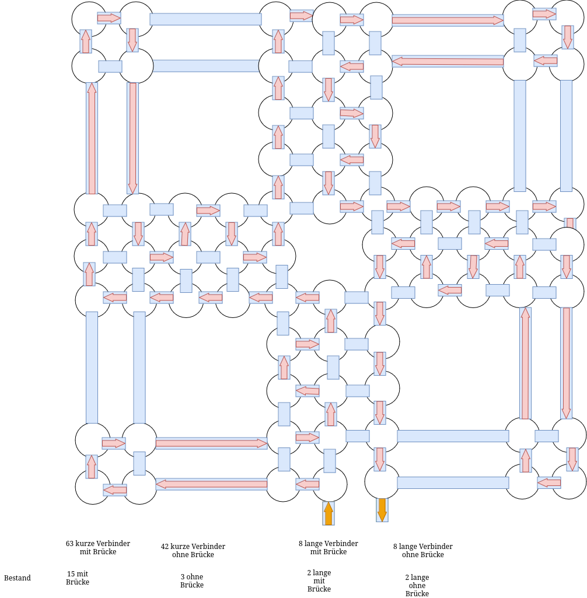

# Build Guide

How to build your own MALN board. This guide collects everything from the
`hardware/` folder, the code and the [project documentation](../docs/Projektdokumentation.pdf)
in build order.

> **Skill level:** You should be comfortable with 3D printing, ordering PCBs,
> soldering and setting up a Raspberry Pi.

---

## 1. Overview

| Part            | What it is |
|-----------------|------------|
| **Game board**  | 3D-printed case in 4 quarters. Under each of the 72 fields sits a small LED board with 2 RGB LEDs (WS2812C). All 72 boards are daisy-chained with connector boards into one LED strip of 144 LEDs. |
| **Raspberry Pi 5** | Built into the case. Drives the LEDs via SPI and the controllers via two I²C buses. |
| **4 controllers** | One per player (yellow, green, red, blue). Each has a 128×64 OLED display, two buttons and an MCP23008 port expander. |

---

## 2. Parts list

Taken from the parts list in the project documentation (appendix 3).

### Electronics

| Qty | Part | Notes |
|-----|------|-------|
| 1   | Raspberry Pi 5 | |
| 1   | Raspberry Pi 27 W USB-C power supply | |
| 1   | Raspberry Pi 5 fan/cooler | |
| 1   | microSD card (64 GB was used) | |
| 4   | OLED display 0.96", 128×64, I²C, SSD1306 (e.g. DEBO OLED5 / joy-it SBC-OLED01) | Needs a selectable I²C address (0x3C / 0x3D) |
| 4   | MCP23008-E/P I²C port expander (DIP) | |
| 8   | Push buttons | 2 per controller |
| 4   | USB-A socket breakout board (DEBO USB-A F) | Connection for the controllers |
| 72 (+spares) | **LED board** (`pcb/RGB-Platine`) | 75 were ordered |
| 105 | **Short connector board** (`pcb/Kurzes-Verbindungsstueck`) | 63 with bridge, 42 without – see [section 4](#4-circuit-boards) |
| 16  | **Long connector board** (`pcb/Langes-Verbindungsstueck`) | 8 with bridge, 8 without |
| –   | Perfboard, wire, solder | For the controllers |
| 1 each | Micro-HDMI extension, Cat7 Ethernet extension, 2× USB-A 3.0 extension, 2× USB-C extension | Bring the Pi's ports to the outside of the case |

### Materials

| Qty | Part |
|-----|------|
| 1 kg | PETG filament 1.75 mm, transparent |
| 1 kg | PLA filament 1.75 mm, black |
| 1 kg | PLA filament 1.75 mm, yellow |
| 1 kg | PLA filament 1.75 mm, white |
| –    | PLA in red, blue, green (controller tops, case) |
| 1    | Set of 100 small round acrylic mirrors |

The original project cost was about €400.

---

## 3. 3D printing

All files are in [`3d-print/`](3d-print/). **The file name tells you how many to print and in which color:**
`<count>x <color> - <part>.stl`. The original model is on Tinkercad (link file in the same folder).

| Group | Files | Count |
|-------|-------|-------|
| **Case** (one set per quarter: *Mensch*, *ärgere*, *Licht*, *nicht*) | `Rot - Gehäuse-*`, `Schwarz - Viertel *`, `Ockergelb - Viertel *`, `Schwarz - Tubes-Top-*`, `Schwarz - Tubes-Bottom-*` | 1 of each per quarter |
| **Light guides** (one set per field) | `Transparent - Light-Inner`, `Transparent 5% Infill - Light-Outer`, `Schwarz - Tubes-Inner`, `Schwarz - Light-Blocker` | 72 each |
| **Case extras** | `Schwarz - Fuß` (feet) | 9 |
| | `Schwarz - Power Button`, `Schwarz - Steckerhalterung` (connector holder), `Schwarz - Flexkabelabdeckung` (flex-cable cover) | 1 each |
| | `Transparent - LED-Abdeckung-PWR-und-ACT` (Pi status LED cover) | 2 |
| **Controllers** | `Rot-Blau-Gelb-Grün - Controller-Top` (one per player color) | 4 |
| | `Weiß - Controller Bottom`, `Weiß - Controller Buttons` | 4 each |

Tips from the project:
- Print `Light-Outer` with **5 % infill** as the file name says. It spreads the light best.
- For the light guides, the long version with **sanded top and bottom faces** (grit 240 and 320) gave the best result.
- Plain white PLA is **not** suitable for the case because it lets light through.

---

## 4. Circuit boards

All three boards were designed in EasyEDA and manufactured by JLCPCB.
Each folder in [`pcb/`](pcb/) contains:

- `Gerber_*.zip`: upload this file to the PCB manufacturer.
- `SCH_*.pdf`: the schematic.
- `3D_*.step`: a 3D model, for checking fit in the case.

### LED board – `pcb/RGB-Platine`

- 2× WS2812C RGB LEDs in series, plus 2× 47 nF capacitors.
- 4 three-pin connectors: **3 inputs** (H1–H3, connected in parallel, so the signal can come from any side) and **1 output** (H4).
- The folder includes the **BOM** and **pick-and-place** file, so you can have JLCPCB assemble the boards.

### Connector boards – `pcb/Kurzes-Verbindungsstueck` and `pcb/Langes-Verbindungsstueck`

- They link two LED boards. All three lines go through: **pin 1 = 5 V, pin 2 = data, pin 3 = GND**.
- The data line has a **0 Ω resistor (R1)**. This is the **"bridge" (Brücke)**:
  - **With bridge** (R1 fitted): power **and** data pass through. These form the LED chain.
  - **Without bridge** (R1 left empty): only power and GND pass through. These add extra power paths between boards without breaking the chain order.
- The short and long versions have the same circuit and differ only in length.

---

## 5. Wiring the game board



[`schematics/spielbrett_verkabelung.png`](schematics/spielbrett_verkabelung.png) shows the whole board from above:

- **Circles** = LED boards (one per field)
- **Red arrows** = connector boards **with bridge**. Follow the arrows to see the data path through all 72 boards.
- **Blue bars** = connector boards **without bridge** (power only)
- **Orange arrows** (bottom) = where the chain enters and leaves the board

Required connectors: **63 short + 8 long with bridge, 42 short + 8 long without bridge**.
(The "Bestand" row at the bottom of the diagram shows the stock at the time and can be ignored.)

### Connection to the Raspberry Pi

| Signal | Raspberry Pi pin |
|--------|------------------|
| LED data (DIN of the first board) | **GPIO10 / SPI0 MOSI** (physical pin 19) |
| GND | any GND pin |
| 5 V | 5 V supply. Make sure it can deliver enough current for 144 LEDs. |

The code drives the LEDs with `neopixel_spi`, color order GRB (see `GUI/Physical/GuiPhysical.py`).

### LED order

The code expects the LEDs in a fixed order. The lookup table `get_index_from_map()` in
`GUI/Physical/GuiPhysical.py` maps every logical field to its position in the chain:

- On each LED board, the **first LED is the background layer** and the **second LED is the front layer**
  (chain positions 0/1, 2/3, …).
- The **first board in the chain is track field 71** (chain positions 0 and 1).
- See [docs/ARCHITECTURE.md](../docs/ARCHITECTURE.md#5-the-play-field-index-map) for the field numbering.

If you wire the chain differently, you must adjust this table.

---

## 6. Controllers

Each controller is soldered on perfboard following one of the diagrams in [`schematics/`](schematics/)
(editable Fritzing sources in [`schematics/fritzing/`](schematics/fritzing/)).

### Circuit (same for all four)

| From | To |
|------|----|
| MCP23008 VDD (18), OLED VIN | Pi 5 V |
| MCP23008 VSS (9), A1 (4), A2 (3), OLED GND | Pi GND |
| MCP23008 SCL (1), OLED SCL | Pi SCL (bus depends on controller, see below) |
| MCP23008 SDA (2), OLED SDA | Pi SDA (bus depends on controller, see below) |
| MCP23008 GP0 (10) | Button S1 → GND – **Enter** (left button: roll / confirm) |
| MCP23008 GP1 (11) | Button S2 → GND – **Next** (right button: change selection) |
| MCP23008 A0 (5) | GND or VDD (sets the address, see below) |

The buttons need no resistors. The code turns on the internal pull-ups.

### The four variants

The file name `controllerXY` encodes the I²C bus (**X**) and address variant (**Y**).
Which player uses which variant is defined in
`Game/GameField/Player/IO/config/physicalAddressConfig.py`:

| Player | Schematic | I²C bus | Pi pins (SDA / SCL) | MCP23008 A0 | Port expander | OLED address |
|--------|-----------|---------|---------------------|-------------|---------------|--------------|
| Yellow | `controller10` | 1 | GPIO2 / GPIO3 (pins 3 / 5)   | GND | 0x20 | 0x3C |
| Green  | `controller11` | 1 | GPIO2 / GPIO3 (pins 3 / 5)   | VDD | 0x21 | 0x3D |
| Red    | `controller01` | 0 | GPIO0 / GPIO1 (pins 27 / 28) | VDD | 0x21 | 0x3D |
| Blue   | `controller00` | 0 | GPIO0 / GPIO1 (pins 27 / 28) | GND | 0x20 | 0x3C |

> **OLED address:** The diagrams don't show this. Set the address on the display module
> itself (usually a solder jumper on the back) to match the table.

The controllers connect to the case through USB-A sockets (4× DEBO USB-A F in the parts list).
As far as the documentation shows, the USB connector is only used as a cheap 4-pin plug for
**5 V, GND, SDA and SCL, not for USB data**. Check your own wiring, and never plug a controller
into a real USB port, or a USB device into the board's controller sockets.

---

## 7. Raspberry Pi setup

1. Flash Raspberry Pi OS onto the microSD card.
2. Turn on **SPI** and **I²C**: `sudo raspi-config` → *Interface Options*.
3. Turn on the **second I²C bus on GPIO0/1** (used by the red and blue controllers).
   These pins are normally reserved for HAT detection. One way is to add `dtparam=i2c_vc=on`
   to `/boot/firmware/config.txt`. Check the Raspberry Pi documentation for your OS version.
4. Reboot and check:
   ```bash
   ls /dev/i2c-* /dev/spidev*     # i2c-0, i2c-1 and spidev0.0 should exist
   sudo apt install i2c-tools
   i2cdetect -y 0                 # expect 20, 21, 3c, 3d (red + blue controllers)
   i2cdetect -y 1                 # expect 20, 21, 3c, 3d (yellow + green controllers)
   ```
5. Install the software as described in the main [README](../README.md#running-on-the-raspberry-pi):
   clone to `/root/game`, create the `.venv`, install `requirements.txt`, switch `main.py` and
   `playerConfig.py` to the physical settings, and install `deploy/madn.service`.

---

## 8. First test

1. Start with only the Pi and the LED chain connected. Set `physicalGUI` in `main.py`, but keep
   keyboard/console input in `playerConfig.py`. Choose the number of players and roll for the
   play order in the console. Then the LEDs switch on, and all fields should light up in the
   dimmed start colors.
2. Then connect the controllers one by one and run `i2cdetect` again after each one.
3. Finally set `"Physical"` / `"LCDDisplay"` in `playerConfig.py` and play a full game.

---

## Not documented yet

- **Power supply for the LEDs:** which supply was used, and where 5 V is fed into the LED chain.
- **Mechanical assembly:** how the light guides, light blockers and acrylic mirrors fit in the case,
  and how the boards are mounted.
